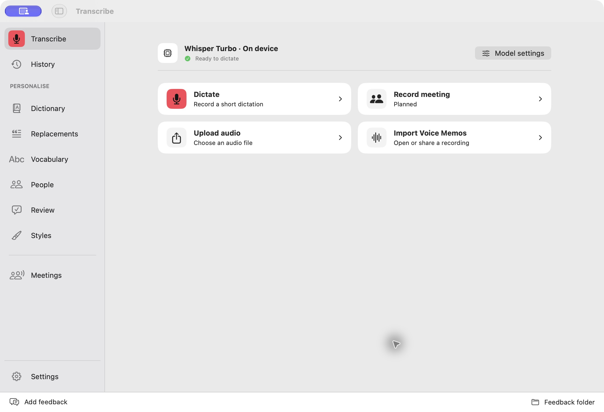
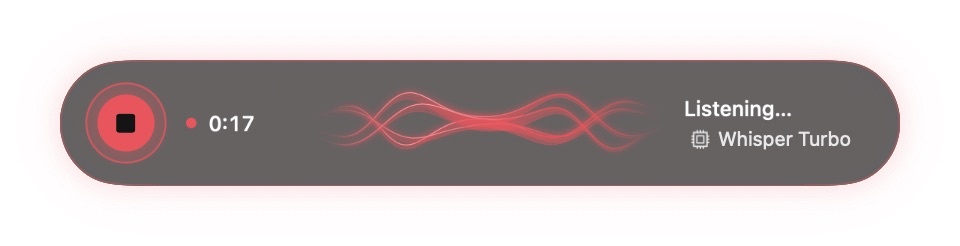

# Schwa

**Words without work.**

Native dictation and transcription for macOS, built with SwiftUI.

[Downloads](https://github.com/Promostrat/Schwa-Releases/releases/latest) · [Changelog](CHANGELOG.md) · [Feature status](#status-and-roadmap) · [Report an issue](https://github.com/Promostrat/Schwa-Releases/issues)

**macOS 14+** · **Apple Silicon & Intel** · **Early testing**

> **Schwa 0.1.2 (build 8) is available:** [Download for Mac](https://github.com/Promostrat/Schwa-Releases/releases/download/v0.1.2-8/Schwa-0.1.2-8.zip). Developer ID signed and notarized. iOS development is ongoing; this testing release focuses on Mac.

## A quieter way to get words down

Record a thought, transcribe imported audio, or dictate into another app. Choose an installed local model or a configured cloud provider, optionally clean up the text, and keep the original recording available in History.

## Features

| | |
| --- | --- |
| **Dictate across apps** | Global shortcut, floating recording control and Accessibility-based paste dispatch |
| **Choose your engine** | Installed on-device models or configured cloud transcription providers |
| **Keep the original** | Retained audio, transcription history, playback and reprocessing |
| **Clean up text** | Configurable cleanup model and supported reasoning level; raw text preserved |
| **Control your input** | System-default or explicit microphone, input gain and audio import normalization |
| **Make it yours** | Dictionary, replacements, popup style, size, transparency and saved position |
| **Stay in the flow** | Menu-bar access, Escape cancellation and local screen feedback |

### Compact dictation

The optional Minimal popup keeps the timer, waveform, model and recording control together. Adjust its size in General settings and drag it to your preferred position.

## Download and quick start

1. Download the app ZIP from [Releases](https://github.com/Promostrat/Schwa-Releases/releases/latest).
2. Extract it and move the app into **Applications**. Older archives use the WhisperGO name.
3. Open the app and follow the microphone and Accessibility setup instructions.
4. In Settings, install/select a local transcription model or configure your preferred cloud provider with your own API key.
5. Choose your microphone, configure the start/finish shortcut, and make a short test recording. **Escape** cancels dictation and retains recoverable audio.

Models, API keys and recordings are not included in the download. Each Mac needs its own setup. Screenshot feedback requires macOS 14.4 or later.

## Updates and changelog

Release builds use **Sparkle** for update checks. Use **Check for Updates** in the app or menu-bar controls. Source changes do not automatically publish an update.

- [Latest published release](https://github.com/Promostrat/Schwa-Releases/releases/latest)
- [Development changelog](CHANGELOG.md)

## Feedback

Enable **Feedback mode** in **Settings → Diagnostics**, then choose **Add feedback** or press **Command–Shift–F**. Mark an area, add comments and save a local report. Reports include a screenshot and a browser-readable review; nothing is uploaded automatically.

Use **Feedback folder** to find saved reports. Review visible content before sharing. For bugs, include the app version, macOS version, selected model/input and steps to reproduce.

## Status and roadmap

Schwa is ready for focused development testing, not a claim of complete production validation. See the feature status below for implementation status and remaining acceptance checks.

- Meetings, Vocabulary, People, Review and Styles include planned workflows.
- Direct ChatGPT-plan cleanup needs live authorization/inference and eligibility verification.
- iOS keyboard/background sessions and cross-device sync require further work and physical-device testing.
- Long-audio silence removal and accelerated transcription are planned experiments.

